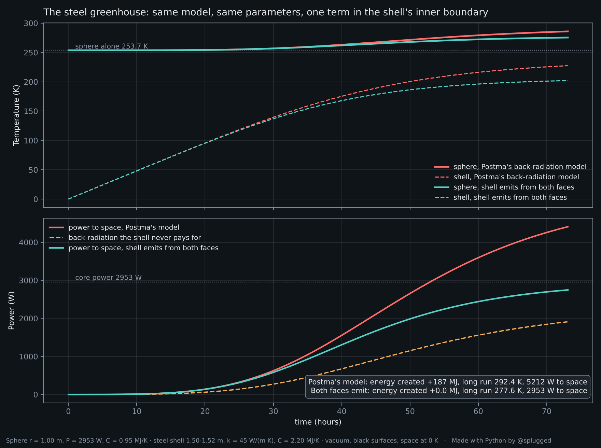

# The Steel Greenhouse, one term at a time

A heated sphere in vacuum, wrapped in a thin steel shell. Does the shell make the sphere warmer?

Joseph E. Postma says no, and that the opposite answer violates conservation of energy. He has published simulations to show it. His code is not public, but his figures print the equations and every parameter. This repository rebuilds the model **from those equations and parameters**, reproduces his results **number by number**, and shows where the "created" energy comes from: **one term in the shell's inner boundary condition**.

**Interactive page:** `https://Davey811.github.io/steel-greenhouse/` (flip the switch and watch the energy ledger)



## Where the model comes from

Postma has not published his code. His figures, however, print the full model: the heat-conduction equation in the shell, the shell's inner and outer boundary conditions, the sphere's energy balance, and all parameters (radii, power, densities, heat capacities, conductivity, starting temperatures, run length). `steel_greenhouse.py` implements exactly those equations. The test of a faithful reconstruction is the output: it matches his figures to the decimal, including the 1912 W he labels "created".

Not to be confused with the original. Willis Eschenbach's 2009 steel greenhouse already has the shell emitting from both faces ("although a sphere only has one side, a shell has two sides") and gets 470 W/m² at the surface. The absorb-only inner face is Postma's: it comes from his 2013 critique, "Revisiting the Steel Greenhouse", and from his later simulations. In this repository, "Postma's model" means only the latter.

## The numbers

Sphere r = 1.00 m, core power 2953 W (235 W/m²), C = 0.95 MJ/K. Steel shell 1.50–1.52 m, k = 45 W/(m·K), C = 2.20 MJ/K. Black surfaces, vacuum, space at 0 K, shell starting at 0 K. Run length 73.1 h, as in his figures.

| "Back-radiation" run, at 73.1 h | Postma's figure | `steel_greenhouse.py` |
|---|---|---|
| sphere temperature | 286.0 K | 286.0 K |
| shell temperature | 227.5 K | 227.5 K |
| power to space | 4412 W | 4409 W |
| back-radiation onto sphere | 1912 W | 1910 W |
| energy created (total) | 187.6 MJ | 187.2 MJ |
| long-run limit, sphere / shell | 292.4 K / 237.1 K | 292.4 K / 237.2 K |

His own figure labels the created energy: **"1912 W created (= P_back)"**.

Now change one term, so that the shell's inner face also emits:

| Shell emits from both faces | `steel_greenhouse.py` |
|---|---|
| sphere at 73.1 h | 275.5 K (his dashed "energy-conserving variant" curve) |
| energy created | 0.0 MJ |
| long-run limit, sphere / shell | **277.6 K / 205.8 K** |
| power to space, long run | **2953 W**, exactly the core's power |

The sphere ends up **23.9 K warmer** than without the shell, and energy is conserved to the last watt.

## The one term

In Postma's simulation the shell's inner face absorbs the sphere's radiation and never emits inward:

```
-k dT/dr |inner = sigma * T_sp^4 * (r_sp/r_in)^2
```

In his "back-radiation" run the sphere also receives `A_sp * sigma * T_in^4` from the shell, but that term never appears in the shell's balance. The same energy is received by the sphere and kept by the shell: it is counted twice. That is the 1912 W of "created" energy.

With the inner face emitting, as any absorbing surface does:

```
-k dT/dr |inner = sigma * (T_sp^4 - T_in^4) * (r_sp/r_in)^2
```

Why the sphere receives exactly `A_sp * sigma * T_in^4` from the shell, for black concentric spheres:

- the inner face emits `A_in * sigma * T_in^4` in total, inward;
- everything the sphere emits reaches the shell, so the sphere-to-shell view factor is 1;
- by reciprocity (`A_sp * F_sp->sh = A_in * F_sh->sp`) the shell-to-sphere view factor is `A_sp/A_in`;
- so the sphere receives `A_in * sigma * T_in^4 * A_sp/A_in = A_sp * sigma * T_in^4`. The rest, a fraction `1 - A_sp/A_in`, crosses the cavity and lands back on the shell.

A Monte Carlo ray count gives the same fraction (0.2498 for a shell at twice the radius, against 0.25). So what the sphere gains, the shell loses. Nothing else changes.

## Why the inner face must emit

Kirchhoff's law: a surface that absorbs infrared also emits it. It follows from the second law of thermodynamics. A surface that absorbed without emitting, placed inside a cavity at uniform temperature, would warm itself above the cavity, with no work done. The shell in Postma's model is exactly such a surface.

## Steady state, any shell

Thin black shell of radius `r_sh`, sphere of radius `r_sp`, core flux 235 W/m²:

```
sigma * T_sp^4 = 235 * (1 + (r_sp/r_sh)^2)
```

- shell touching the sphere: 470 W/m², 301.7 K (+28.6 °C)
- Postma's geometry, 1.52 m: 336.7 W/m², 277.6 K
- shell twice the radius: 293.75 W/m², 268.3 K (−4.9 °C)
- shell at infinity: 235 W/m², 253.7 K, as without it

For a grey shell of emissivity ε on both faces the factor becomes `1 + (r_sp/r_sh)^2 * (2/ε − 1)`: a less emissive shell insulates better.

In every case space receives exactly the core's power, and net heat flows from the warmer sphere to the cooler shell. The shell does not heat the sphere; the core does. The shell reduces how fast the sphere loses heat, so the sphere has to be warmer to get rid of the same power.

## Not just on paper

- Spacecraft keep instruments warm in vacuum with radioisotope heater units, a plutonium-238 pellet of about 1 W each (NASA), wrapped in multilayer insulation that helps retain internal heat (NOAA).
- Roy Spencer showed on a table top (2016) that a cooler object can make a heated object warmer still.

## Run it

```
python3 -m venv .venv
source .venv/bin/activate
pip install -r requirements.txt
python3 steel_greenhouse.py              # 73.1 h, his run length
python3 steel_greenhouse.py --hours 500  # closer to the long-run limits
```

The script solves the radial heat-conduction equation through the steel wall (finite volumes, implicit BDF integrator) coupled to the sphere, prints the table above to `results/results.txt` and writes `results/one_term.png` and `results/any_radius.png`.

`index.html` is a self-contained interactive version with a lumped model (one temperature for the sphere, one for the shell; the wall's conduction drop is 0.05 K, so the results agree).

To publish the page: repository **Settings → Pages → Deploy from a branch → main, / (root)**.

## References

- W. Eschenbach, "The Steel Greenhouse", Watts Up With That, 17 November 2009. https://wattsupwiththat.com/2009/11/17/the-steel-greenhouse/
- J. E. Postma, "Revisiting the Steel Greenhouse", Climate of Sophistry, 8 December 2013. https://climateofsophistry.com/2013/12/08/revisiting-the-steel-greenhouse/
- J. H. Lienhard IV and J. H. Lienhard V, *A Heat Transfer Textbook*, sec. 2.1 (energy balance with internal heat generation). https://ahtt.mit.edu/
- NASA, Radioisotope Heater Units. https://science.nasa.gov/planetary-science/programs/radioisotope-power-systems/thermal-radioisotope-heater-units
- NOAA NESDIS, multi-layer insulation. https://www.nesdis.noaa.gov/node/87
- R. Spencer, "Experiment Results Show a Cool Object Can Make a Warm Object Warmer Still", 2016. https://www.drroyspencer.com/2016/08/experiment-results-show-a-cool-object-can-make-a-warm-object-warmer-still/
- B. Loblaw, "The Dynamics of the Green Plate Effect", Skeptical Science, 2023. https://skepticalscience.com/green-plate-dynamics.html

Code under the MIT licence. Made with Python by [@splugged](https://x.com/splugged).
